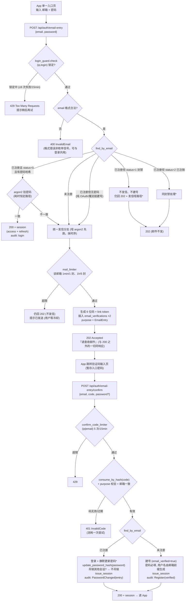

# Email Entry：邮箱登录/注册统一入口

> 状态：已实现（2026-11-24）。service 层 + 路由 + 测试就绪，按平台矩阵发信。
> 结论先行：一个框收邮箱+密码；密码对直接登录；其余一切走同一封验证邮件，收码即登录并静默更新密码。响应只有 200/202 两种，注册状态零泄露。

## 1. 目标与取舍

| 目标 | 达成方式 |
|---|---|
| 一次输入（邮箱+密码同框） | 单一入口端点，不再分注册/登录 UI |
| 不泄露注册状态 | 响应仅 200（凭据有效）/ 202（其余一切）；每个被提交的邮箱都发信（消灭"无邮件=未注册"信号）；哑 argon2 抹平时序差 |
| 密码错不尴尬 | 错了也一样收到码，收码即登录+静默换密，用户少一步"找回密码" |
| 兼容现有体系 | 现有 login / signup / magic link / password-reset 端点全部保留，App 渐进迁移 |

**放弃的**："密码错误"提示（与防枚举原理性冲突，任何差异化响应都是枚举预言机）。

## 2. 流程图



\* 标注点见 §3 场景分析。

**PC 链接分支**：暂缓（网页端未开发）。链接与码双记录结构（B-2）保留在 signup 流程中，entry 当前为码单记录。

### 平台矩阵（按 X-Client-Platform 自报）

EMAIL_CHANNELS 全局开关**仍封顶**一切平台（全局关 = 所有平台都关）。
平台矩阵只决定在全局配额内渲染哪些凭据段：

| 平台（X-Client-Platform） | 码 | PC 链接 | dp 链接 | 说明 |
|---|---|---|---|---|
| `app` / `android` | ✅ | ❌ | ✅（scheme 就绪时） | App 场景：码可跨端输，dp 一键回 App |
| `web` / `pc` / 其他/缺省 | ✅ | （暂缓） | ❌ | 网页/PC 链接待网页端开发时再进矩阵 |
| `ios`（预留） | ✅ | ❌ | ✅（同 app） | 与 app 同组 |

- dp 格式：`{EMAIL_APP_LINK_SCHEME}://entry?code={code}`（码而非 token，暴露面更小）。
- 伪造 X-Client-Platform 只影响**自己**收到的邮件内容，无攻击面。
- 判定实现：`EmailChannels::for_platform`（service/mod.rs）——app/android/ios → 关 PC 链接；其余 → 关 dp。

**邮件模板**（三情形完全同一封，中性文案；凭据段按平台矩阵渲染）：

> 你请求继续使用 Rovortex。输入此验证码（15 分钟内有效，仅可使用一次）：
> `123456`
> （app 平台另渲染 dp 按钮：继续 → rovortex://entry?code=123456）
> 如果你没有发起过此操作，请忽略本邮件。

## 3. 场景分析（你问的"还有没有其他情况"）

按入口与 confirm 两个阶段穷举：

### 入口阶段（request）

| # | 场景 | 处理 | 说明 |
|---|---|---|---|
| 1 | 已注册 + 密码对 | 200 直登 | 唯一的 200 出口 |
| 2 | 已注册 + 密码错 | 202 + 发码邮件 | merge 统一分支；login_guard 计失败 |
| 3 | 已注册 + 无密码（OAuth 建号） | 202 + 发码邮件 | 与 #2 外部不可区分 |
| 4 | 未注册 | 202 + 发码邮件 | confirm 时才建号 |
| 5 | **已注册但封禁（status=1）** | 202 但**不发信** | 不能给封禁号发码（否则码成为绕过封禁的登录凭据！）；响应仍是 202 保持不可区分；发信哑路径跑哑 argon2 保时序 |
| 6 | **已注册但已注销（status=2，冷静期内）** | 202 不发信 | 同 #5 逻辑——注销态不该被 entry 绕过恢复（恢复有专门流程）；同样保 202 |
| 7 | 邮箱格式非法 | 400 | 格式错误不构成注册状态信号（未注册/已注册都可能是格式错） |
| 8 | 同邮箱高频提交 | mail_limiter 拦（仍 202） | 1min/1 封、1h/5 封 |
| 9 | 单 IP 高频（不同邮箱） | 入口建议加 ip 维度限流* | mail_limiter 是 per-email 的；枚举者轮换邮箱可绕。建议入口加 `ip` 桶（如 10/min），实现时复用 ConfirmCodeLimiter 模式 |
| 10 | 已注册 + 密码对但**多次**直登成功 | 正常 | login_guard 只计失败，成功清零（现有语义） |

### confirm 阶段

| # | 场景 | 处理 | 说明 |
|---|---|---|---|
| 11 | 码错/过期/重放 | 401，计 confirm_code_limiter | 现有机制原样 |
| 12 | 码对 + 已注册 | 登录 + 静默设密 | password 可选：App 忘带暂存密码时退化为纯登录（码=登录凭据，等同 magic link 语义）|
| 13 | 码对 + 未注册 | 建号，password 必填 | 缺密码 400（建号必须有初始凭据或明确无密——见 #15）|
| 14 | **码对 + 但账号在收码后、confirm 前被封禁** | 拒绝（AccountBanned） | issue_session 里已有封禁检查，天然覆盖；静默设密也应跳过（先查 status 再 update） |
| 15 | **码对 + 已注册 + password 缺省** | 只登录不设密 | 兼容无密码 App 实现；纯 OAuth 用户想保持无密也走这条 |
| 16 | **码通道 vs 链接通道交叉** | 各自独立记录 | 沿用 B-2：码与 link token 是两条 verification 记录，任一有效即成功，互不干扰 |
| 17 | **Entry 码被拿去当 password-reset 码用** | 拒绝 | purpose 校验拦截（现有 consume_by_hash 返回 purpose，各 confirm 严格比对）——与"signup 码不能当 reset 用"同防御 |
| 18 | confirm 时邮箱与码不匹配 | 拒绝 | eq_ignore_ascii_case 校验（沿用 B-3 语义） |

### 横切关注

| # | 场景 | 处理 |
|---|---|---|
| 19 | 时序侧信道 | request 阶段所有非"密码对"路径统一先跑一次哑 argon2（固定成本）；密码对路径本来就是 argon2，天然对齐 |
| 20 | 邮件轰炸滥用 | 攻击者拿别人邮箱轰炸：mail_limiter per-email 已限；**注意** 202+不发信窗口内仍计 limiter 配额，防"探测配额边界" |
| 21 | 与现有 login 并存 | 互不影响；login_guard 实例共享（同一进程内同一把锁）——entry 密码错计入的失败同样能锁 login 端点，反之亦然。**这是想要的**：绕端点轰炸无意义 |
| 22 | 已注销账号想回来 | 走专门 recovery 流程；entry 对 status=2 不发信（#6），App 侧无需引导（恢复是低频操作） |

## 4. 服务端改动清单（已实现）

| 改动 | 位置 | 状态 |
|---|---|---|
| `VerificationPurpose::EmailEntry` | crates/users/src/email_verification.rs | ✅（DB 存字符串，无迁移）|
| `EmailChannels::for_platform`（平台矩阵） | crates/users/src/service/mod.rs | ✅ |
| `request_email_entry(email, password, platform, ip, ctx)` | service/email_entry.rs | ✅（含 login_guard 接线 + 哑 argon2）|
| `confirm_email_entry(email, code, password?, ip, ctx)` | service/email_entry.rs | ✅（码单记录；已注册=登录+可选静默设密，未注册=建号）|
| 路由 `POST /api/auth/email-entry` + `/confirm` | gateway_api/src/routes/email_entry.rs | ✅（X-Client-Platform 头解析；confirm 接 confirm_code_limiter）|
| 测试 | service/tests.rs（12 个 entry_* 用例） | ✅ 覆盖 §3 #1-#7/#12-#15/#17/#18/#21 + 平台矩阵 |
| PC 链接落地页 | — | 暂缓（网页端未开发）|

与设计的差异：entry 邮件为**码单记录**（设计稿的双记录 link 通道随 PC 落地页一并暂缓）；平台矩阵取代全局-only 通道配置（全局开关仍封顶）。

## 5. 与现有端点的关系

```
email-entry (新，推荐 App 主入口)
    │
    ├── 复用：EmailChannels 模板机制 / mail_limiter / confirm_code_limiter
    │         login_guard / issue_session / create_verified_user
    │
    └── 不动：/api/users/login（密码登录老路径）
             /api/auth/signup/*（注册双通道，PC 落地页仍用）
             /api/auth/password-reset/*（找回密码，独立场景）
             /api/auth/magic-link/*（可视为 entry 的无密码特例，保留）
```
